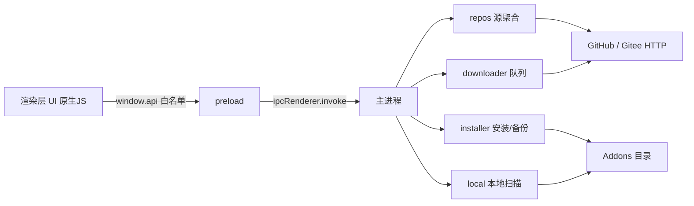

## 用户需求

做一个天际线 1（Cities: Skylines）的 Mod 助手桌面程序。**核心诉求是下载 Mod**，下载源不是 Steam 创意工坊，而是用户自己维护的 **GitHub / Gitee 仓库**（Release 资产或 raw 清单），全程不依赖 SteamCMD 与 Steam 订阅。程序形态为 Electron 桌面应用，可读写本地文件，界面走**霓虹风**。

## 产品概述

一个「自建源驱动」的 Mod 分发客户端：用户把自己的 Mod 打包发布到自己或朋友的 GitHub / Gitee 仓库，助手把多个仓库聚合成一个统一商店，提供搜索浏览、一键下载、自动安装到游戏目录、版本更新与依赖补齐。整体是深色霓虹视觉的单窗口桌面应用，带自定义无边框标题栏与动态辉光背景。

## 核心功能

- **源管理**：添加/删除 GitHub、Gitee 仓库（owner/repo），选择读取方式（仓库内 mods.json 清单，或自动解析 Releases 发布物），多源结果自动合并去重。
- **发现与搜索**：聚合所有源的 Mod 列表，支持关键字搜索、按类型/标签筛选、按更新时间或下载量排序；点击卡片弹出详情（简介、作者、版本、体积、依赖列表、更新日志）。
- **下载**：任务队列（默认并发 3）、断点续传、失败自动重试、可选镜像加速前缀，实时显示单个与总体进度。
- **安装与本地管理**：下载后自动解压并安装到天际线本地 Mod 目录，安装前校验包完整性、拒绝非法路径；已安装列表支持启用/禁用、卸载、备份回滚。
- **更新与依赖**：扫描本地版本并与源清单比对，标出可更新项并支持批量更新；依赖缺失时给出提示并可一键补齐。
- **设置**：自动探测天际线用户数据目录（也允许手动指定）、镜像地址、并发数、缓存清理。

## 视觉要求

深色底（近黑蓝）配青色与洋红的霓虹双主色，卡片为半透明玻璃质感 + 细描边，悬停时描边发光与轻微上浮；背景为静默流动的网格与扫描线；下载项显示环形发光进度；标题栏与侧边导航延续霓虹线条语言。整体要求「一眼惊艳」，而非普通管理工具。

## 技术栈

- **运行时**：Electron（Node 22，本机已有 v22.11.0 / npm 10.9.0），主进程承担全部文件与网络 IO。
- **渲染层**：原生 HTML + CSS + 原生 JS（无框架），符合用户既有工程习惯；CSS 变量驱动设计令牌，不引入 UI 库。
- **依赖**：`adm-zip`（解压）、`semver`（版本比对）、`electron-builder`（打包）。网络使用 Node 内置 `https`/`http`，不引入额外 HTTP 客户端。
- **打包**：electron-builder 产出 NSIS，沿用用户习惯的 `disable-sign.js` 空签名配置，跳过证书步骤产出未签名安装包。

## 实施方案

### 双通道清单聚合

1. **清单通道（首选）**：仓库根目录放 `mods.json`，通过 `https://raw.githubusercontent.com/<owner>/<repo>/<branch>/mods.json` 或 `https://gitee.com/<owner>/<repo>/raw/<branch>/mods.json` 拉取，字段完备（id/name/version/type/tags/desc/deps/downloadUrl/sha256/size/homepage）。
2. **Releases 通道（兜底）**：GitHub `api.github.com/repos/<owner>/<repo>/releases`、Gitee `gitee.com/api/v5/repos/<owner>/<repo>/releases`；把 tag 当版本、name 当 Mod 名、`.zip` asset 当安装包、body 当更新日志。公开仓库无需 token，设置里可选填 token 提升限流额度。

两通道归一成统一 `ModEntry` 后按 `id` 合并且多源去重，结果落盘 `userData/cache/catalog.json`（TTL 30 分钟，可手动刷新）。这样用户换仓库只改配置不改代码，扩展性最强。

### 下载引擎

- 任务入队 → 检查本地已有 `.part` 文件 → 带 `Range: bytes=N-` 续传写 `.part` → 完成后校验 `sha256`（清单提供时）→ 原子重命名为 `${id}.zip`。
- 失败按指数退避重试 3 次；镜像前缀仅对 GitHub 域名的 URL 生效，Gitee 走原地址。
- 进度通过 IPC 推送，主进程 200ms 节流合并，避免高并发时刷爆渲染层。
- 复杂度：单任务 O(文件大小) 流式写盘，内存占用恒定（不整包读入）。

### 安装与安全边界

- 安装目标固定为 `%LOCALAPPDATA%\Colossal Order\Cities_Skylines\Addons\Mods\<目录名>`（本机已实测该目录存在），包内 `mods.json` 可指定 `installTo`（Mods/Assets/Maps）与子目录名。
- 解压前逐条校验条目路径，拒绝绝对路径与 `..`（zip slip）；校验最终路径必须位于 Addons 之下。
- 安装前把同名旧目录整体备份到 `userData/backups/<id>/<version>`，支持回滚与卸载恢复。
- **禁用**不删除文件：移动到 `userData/disabled/<id>`，启用时移回，保持游戏目录干净可逆。
- Electron 安全：`contextIsolation: true`、`nodeIntegration: false`、`webSecurity` 保持开启；preload 只暴露白名单方法，IPC 通道按「下载 / 安装 / 源 / 设置」分组校验参数类型。



## 实现要点

- **游戏路径探测**：优先 `%LOCALAPPDATA%\Colossal Order\Cities_Skylines`，不存在则提示手动选择，设置持久化到 `userData/settings.json`；只验证 Addons 子目录可写来判定有效性。
- **本地扫描**：遍历 `Addons/Mods` 子目录，识别 `*.dll`；有 `mods.json` 元数据则读 id/version，无则用目录名作为 key 并标记「手动安装」，避免误判为可更新项。
- **性能**：列表项超过 200 条时启用增量渲染（分批 requestAnimationFrame 追加），搜索用预建的小写索引串做 `includes`，避免每次重排；catalog 解析结果常驻内存，切页不重新请求。
- **日志与错误**：主进程统一 `log(level, scope, msg)` 写 `userData/logs/app.log`（按 1MB 轮转）；错误在渲染层转成可读中文提示 + 展开的原始信息，不向用户暴露堆栈全量。
- **影响面控制**：所有写操作限于 `Addons` 与 `userData` 两处根目录，任何其他路径一律拒绝，避免误删游戏本体。
- **示例仓库规范**：随仓库提供 `docs/mods.json.example` 与说明文档，用户可直接复制到自己仓库当模板。

## 目录结构

```
f:/天际线mod助手/
├── package.json                        # [NEW] 依赖、scripts(start/dist)、electron-builder 配置；win.sign 指向 disable-sign.js
├── disable-sign.js                     # [NEW] 空签名脚本，跳过 winCodeSign 下载与证书签名
├── main/
│   ├── main.js                         # [NEW] 创建无边框 window（frame:false, titleBarStyle hidden）、单实例锁、注册全部 IPC、窗口控制（最小化/最大化/关闭）、打开外部链接
│   ├── preload.js                      # [NEW] contextBridge 暴露 window.api：searchCatalog/refreshSources/download/install/uninstall/toggle/checkUpdates/openPath/getSettings/saveSettings，全部 invoke 封装
│   └── services/
│       ├── settings.js                 # [NEW] settings.json 读写（游戏目录、镜像前缀、并发、token、源列表），带默认值与校验
│       ├── gamepath.js                 # [NEW] 自动探测 Addons 路径、可写性检查、手动覆盖、返回 Mods/Assets/Maps 绝对路径
│       ├── repos.js                    # [NEW] 单源抓取：mods.json 清单通道 + Releases 通道；统一 ModEntry 归一化、sha256/大小/依赖字段兼容
│       ├── catalog.js                  # [NEW] 多源并发聚合并按 id 去重、内存缓存 + catalog.json 落盘 TTL、搜索筛选排序、依赖图检查
│       ├── downloader.js               # [NEW] 并发队列（信号量）、Range 断点续传写 .part、重试退避、镜像前缀、sha256 校验、节流进度事件
│       ├── installer.js                # [NEW] adm-zip 解压 + zip slip 防护 + 路径白名单、安装/备份/回滚、启用禁用移动、卸载清理
│       └── local.js                    # [NEW] 扫描已装 Mod、读取元数据与版本、与 catalog 比对生成可更新列表
├── renderer/
│   ├── index.html                      # [NEW] 单页骨架：自定义标题栏、左侧霓虹导航（发现/已安装/下载/源与设置）、主内容区、详情抽屉、Toast 容器
│   ├── css/
│   │   ├── tokens.css                  # [NEW] 颜色/字号/间距/圆角/辉光阴影/动效时长设计令牌，霓虹配色单点可改
│   │   └── app.css                      # [NEW] 布局、玻璃卡片、按钮输入、网格与扫描线动态背景、环形进度、hover 辉光上浮、滚动条、空态
│   ├── js/
│   │   ├── api.js                      # [NEW] 封装 window.api 调用 + 统一错误提示 + 本地状态（源列表、catalog、队列）
│   │   ├── render.js                   # [NEW] 增量渲染（分批 rAF）、卡片/列表/DOM 模板函数、骨架屏
│   │   └── app.js                      # [NEW] 视图路由、搜索防抖、下载队列订阅、设置表单、源增删交互、更新检测与批量更新
│   └── assets/
│       └── neon-grid.svg               # [NEW] 背景网格/扫描线纹理，避免 CSS 大量渐变造成的重绘开销
└── docs/
    └── mods.json.example               # [NEW] 自建仓库清单模板 + 字段说明 + Gitee/GitHub 发布步骤
```

## 关键结构

```
// mods.json 清单（放在自建仓库根目录，字段均可选除 id/name/version）
{
  "schemaVersion": 1,
  "mods": [
    {
      "id": "neon-tools",
      "name": "霓虹工具箱",
      "version": "1.2.0",
      "type": "mod",
      "author": "ytlemon",
      "tags": ["工具", "UI"],
      "description": "一站式城市管理增强",
      "installTo": "Mods",
      "dirName": "NeonTools",
      "downloadUrl": "https://github.com/ytlemon/neon-tools/releases/download/v1.2.0/NeonTools.zip",
      "sha256": "……",
      "size": 1048576,
      "deps": ["harmony-2.2"],
      "homepage": "https://github.com/ytlemon/neon-tools"
    }
  ]
}
```

## 设计方向

以「城市夜景 + 霓虹灯管」为灵感的深色科技界面：近黑蓝底、青色与洋红双色光晕、网格地平线与横向扫描光带，构成可呼吸的动态空间感。整体是**桌面端单窗口应用**（1280x800 起），不是网页落地页。

## 框架与实现

原生 HTML + CSS + 原生 JS，无组件库，用 CSS 变量与可复用 class 组合实现「伪组件」，减少依赖与构建复杂度。

## 布局架构

- **自定义标题栏（高 44px）**：左侧霓虹 LOGO「SKYLINE // MOD」与当前视图名，中部可拖动区域，右侧最小化/最大化/关闭按钮（悬停亮青）。
- **左侧导航（宽 220px）**：四项——发现、已安装、下载队列、源与设置。选中项左侧 3px 青色光条 + 背景玻璃渐显；下载队列带洋红数字角标显示进行中数量。
- **主内容区**：顶部工具条（搜索框 + 排序下拉 + 刷新源按钮 + 视图统计），下方内容随导航切换。
- **详情抽屉**：右侧 420px 滑入面板，半透明毛玻璃 + 顶部渐隐遮罩，展示封面、标签、版本、依赖、更新日志与主操作按钮。
- **底部状态条（高 28px）**：显示游戏目录路径、源数量、在线/离线灯。

## 视图块设计

1. **发现**：搜索 + 筛选胶囊（全部/功能/资产/工具），Mod 卡片三列网格。每卡含标题、作者、版本徽章、标签、两行简介、下载按钮与体积/更新时间；悬停描边由青转洋红并发光上浮 4px。空态与加载态用霓虹骨架屏。
2. **已安装**：表格化列表（名称、版本、状态、大小、操作）。可更新行显示洋红「有新版本」脉冲徽章；操作为启用/禁用开关、更新、卸载、备份回滚，行悬停整行淡青光带扫过。
3. **下载队列**：每任务一行，左侧环形发光进度，右侧速度与剩余时间；顶部总体进度长条与「全部暂停/继续」；完成后该行短暂闪绿并提示「已安装」。
4. **源与设置**：上半为源卡片列表（GitHub/Gitee 图标、仓库名、读取方式、Mod 数量、刷新/删除），底部输入框添加新源；下半为设置分组（游戏目录 + 浏览按钮、镜像前缀、并发数滑块、缓存清理、「检查更新」大按钮）。

## 动效与响应

- 背景网格 24s 缓慢下移，扫描光带 6s 横穿，均为 CSS transform/opacity，走合成层不触发布局。
- 视图切换用 180ms 淡入 + 上移 8px；卡片进入错峰 30ms 延迟；按钮按下 0.97 缩放。
- 窗口宽度小于 1100px 时导航收为 64px 图标栏，卡片降为两列；小于 820px 单列并隐藏状态条中段信息。
- 遵循 `prefers-reduced-motion` 关闭背景与悬停动画。

## Agent Extensions

### Skill

- **playwright-cli**
- Purpose: 渲染层是原生 HTML，可脱离 Electron 直接在浏览器打开 `renderer/index.html`，用该 skill 加载页面并截图，验证霓虹视觉（背景动效、卡片辉光、布局断点）是否符合设计预期。
- Expected outcome: 得到发现页、已安装页、源与设置页的截图，确认无布局溢出、配色与辉光效果达标；如发现视觉问题再回改 CSS。